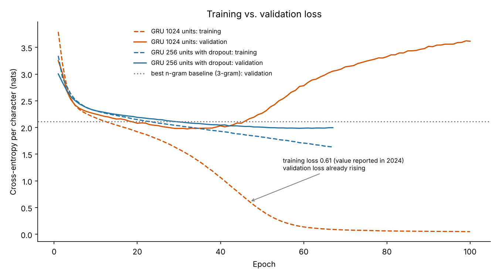

# Swiss German lyrics generator


Can a small neural network learn to write song lyrics in **Bernese Swiss German**, a dialect without a standard spelling and with very little text available? This project trains a character-level language model on lyrics by Mani Matter, Plüsch, Polo Hofer and Gölä, measures how well it generalises, and shows where it stops learning the language and starts memorising the songs.



## Key findings

| Model | Validation loss | Perplexity |
|---|---|---|
| GRU with 1024 units, 30 epochs (setup of the 2024 study) | 1.98 | 7.3 |
| GRU with 256 units and dropout, early stopping | 1.99 | 7.3 |
| Best n-gram baseline (3 characters of context) | 2.11 | 8.3 |

- **The neural network beats a simple counting baseline, but only by about 12 % in perplexity.** With about 52,000 characters of training text (roughly 15 pages), there is not much more to learn.
- **Training longer makes the model worse.** The large network reaches its lowest validation loss after 32 epochs. After that, the training loss keeps falling to 0.05 while the validation loss rises to 3.6: the model memorises the lyrics instead of learning the dialect.
- **Memorisation explains what the 2024 study observed.** The 2024 study reported a training loss of 0.61 and noticed that the model copied whole lines from songs at low temperature. Here a training loss of 0.61 is reached after 47 epochs, when the validation loss is already rising. After 100 epochs, 66–88 % of all five-word sequences the model generates appear verbatim in the training lyrics. Stopped after 30 epochs, or as the smaller model with dropout, it copies less than 5 %.
- **Temperature trades correct words for variety.** At temperature 0.2, 96–97 % of the generated words exist in the training lyrics. At 1.0, only 54–56 % do.

Generated examples: [results/samples.md](results/samples.md). All numbers: [results/metrics.json](results/metrics.json).

## How it works

1. **Data:** one text file per artist. The text is lowercased, umlauts are written as `ae`/`oe`/`ue` and punctuation is removed. The last 10 % of every artist's text is held out for validation, so every artist appears in both sets.
2. **Model:** a character-level GRU (embedding, GRU, dense layer) in Keras. It predicts the next character from the characters before it.
3. **Training:** three runs with a fixed random seed:
   - the setup of the 2024 study (embedding 256, GRU 1024 units, 30 epochs);
   - the same model trained for 100 epochs, to show overfitting;
   - a smaller model (GRU 256 units, dropout 0.3) with early stopping on the validation loss.
4. **Evaluation:**
   - validation loss and perplexity;
   - character n-gram baselines (1, 3 and 5 characters) as a reference point;
   - for generated text: the share of words that exist in the training lyrics, the share of five-word sequences copied verbatim, and the longest copied passage.

**Perplexity** is the exponential of the loss. A perplexity of 7.3 means the model is, on average, as unsure as if it had to choose between about seven equally likely characters (the alphabet has about 30).

## Run it

```bash
pip install -r requirements.txt
python train.py          # about 25 minutes on a laptop CPU
pytest                   # tests for data preparation and metrics
```

The lyrics are protected by copyright and are not part of this repository. Put your own text files into `data/` first, see [data/README.md](data/README.md).

## Repository structure

```
├── train.py              # Trains all models, evaluates them, writes results/
├── lyrics_gen/
│   ├── data.py           # Normalisation, train/validation split, vocabulary
│   ├── model.py          # GRU model and step-by-step text generation
│   ├── baselines.py      # Character n-gram baselines
│   └── metrics.py        # Known-word rate and copy detection
├── tests/
├── results/              # Loss curves, metrics and generated samples
└── data/README.md        # How to provide the training text
```

## Background

This is the second phase of a research project at the Lucerne University of Applied Sciences and Arts (HSLU) and the Swiss Distance University of Applied Sciences (FFHS), 2024. The first phase is the paper [Large Language Models – Text Analysis and Generation in the Era of Generative AI](https://github.com/sreterannamaria/llm-swiss-education-paper).

The 2024 version adapted TensorFlow's [text generation tutorial](https://www.tensorflow.org/text/tutorials/text_generation) to Swiss German and evaluated the output by hand. This version keeps the model architecture and adds a held-out validation set, baselines, automatic metrics, tests and a reproducible training script.

**Authors:** Annamária Sréter, Seraina Fischer, Bigna Schmid

## License

Code: [MIT](LICENSE). The song lyrics used for training belong to their authors and are not distributed here.
